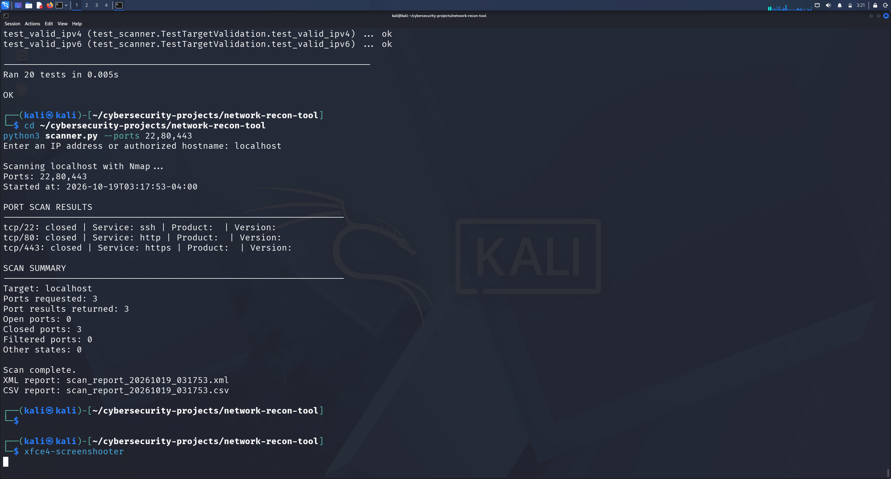

# Python Nmap Network Reconnaissance Tool

A beginner-friendly cybersecurity project built with Python and Nmap
to scan authorized targets, identify network services, summarize port
states, and export results to XML and CSV reports.

## Features

- Accepts IPv4, IPv6, and resolvable hostnames
- Validates target input before scanning
- Uses Nmap service and version detection (`-sV`)
- Supports configurable TCP ports
- Provides default ports: 22, 80, 443, 3306, and 8080
- Validates port numbers and rejects duplicates
- Parses Nmap XML output using Python
- Displays a summary of open, closed, filtered, and other port states
- Exports timestamped XML and CSV reports
- Handles common Nmap execution, timeout, XML parsing, and file errors
- Includes 20 automated unit tests

## Demo

The screenshot below shows the scanner running in Kali Linux, including
port results and the scan summary.



## Requirements

- Python 3
- Nmap
- Git (for cloning the repository)

## Installation

### 1. Install Nmap

On Kali Linux:

```bash
sudo apt update
sudo apt install nmap
```

### 2. Clone the repository

```bash
git clone https://github.com/rishiknarayana22/python-nmap-recon-tool.git
cd python-nmap-recon-tool
```

## Usage

### Scan using the default ports

Run:

```bash
python3 scanner.py
```

Enter an IP address or hostname when prompted.

By default, the scanner checks these TCP ports:

- 22 — commonly used for SSH
- 80 — commonly used for HTTP
- 443 — commonly used for HTTPS
- 3306 — commonly used for MySQL
- 8080 — commonly used as an alternative HTTP port

The actual service running on a port may differ from its typical use.

### Scan selected ports

To scan ports 22, 80, and 443:

```bash
python3 scanner.py --ports 22,80,443
```

To scan a single port:

```bash
python3 scanner.py --ports 8080
```

To view available command-line options:

```bash
python3 scanner.py --help
```

The scanner accepts unique TCP port numbers from 1 through 65535.

## Scan Summary

After a successful scan, the tool displays individual port results
and a summary containing:

- Target scanned
- Number of ports requested
- Number of port results returned
- Number of open ports
- Number of closed ports
- Number of filtered ports
- Number of ports in other states

The number of results returned may be smaller than the number of
requested ports.

## Reports

Each successful scan creates timestamped files similar to:

- `scan_report_YYYYMMDD_HHMMSS.xml`
- `scan_report_YYYYMMDD_HHMMSS.csv`

The XML report contains Nmap's XML output. The CSV report contains
structured port and service information, including:

- Scan timestamp
- Target
- Protocol
- Port number
- Port state
- Service name
- Product and version, where available

Generated reports are excluded from Git using `.gitignore`.

## Running Tests

Run the automated test suite:

```bash
python3 -m unittest -v test_scanner.py
```

The test suite covers:

- Target validation
- XML parsing
- Missing service information
- Malformed XML
- Port parsing and validation
- Scan summary counts
- Empty scan results

## Limitations

- Scans TCP ports only.
- Service and version detection may be incomplete or inaccurate.
- DNS resolution does not guarantee that a host is reachable.
- A scan may return no port records without indicating a programming
  error.
- The Nmap process has a 60-second timeout.
- The tool does not perform vulnerability exploitation or prove that
  a service is vulnerable.

## Technologies

- Python 3
- Nmap
- XML parsing with `xml.etree.ElementTree`
- CSV reporting
- Python `unittest`
- Git and GitHub

## Disclaimer

This project is intended for educational use and authorized network
reconnaissance only.

Only scan systems you own or have explicit permission to test.
Follow applicable laws and organizational policies.
